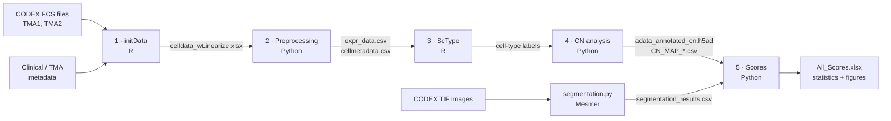

# CODEX / SPACEc spatial analysis of periprosthetic joint infection

Analysis code accompanying:

> **The Spatial Immune Signature of Periprosthetic Joint Infection Persists after Clinical Clearance**. Tony Hong Wei Chang, Robert Manasherob, Lyong Heo, Shay I. Warren, Christopher J. Moore, Rohan Sanda, Chris S. Aboujudom, Prena Arora, Z. Ngalo Otieno-Ayayo, Wilson F. Kuswanto, Robert N. Matar, Maureen Howard, Stuart B. Goodman, Daisuke Furukawa, and Derek F. Amanatullah. Manuscript submitted, October 2026.

This repository contains the code used to process multiplexed CODEX imaging data from tissue microarrays (TMA1, TMA2) and to perform the spatial analyses reported in the manuscript: cell-type annotation, cellular neighborhood (CN) analysis, cell–cell interaction and patch-proximity analyses, and region/patient-level spatial scores compared across **Uninfected**, **Dormant** and **Infected** groups.

- **Cohort analysed:** 32 patients, 85 TMA regions, 336,051 cells
- **Panel:** 29 protein markers (CD45 … Ki67), plus DRAQ5 / Hoechst nuclear stains
- **Main frameworks:** [SPACEc](https://github.com/yuqiyuqitan/SPACEc), [scanpy](https://scanpy.readthedocs.io), [ScType](https://github.com/IanevskiAleksandr/sc-type), [Mesmer / DeepCell](https://github.com/vanvalenlab/deepcell-tf)

---

## Repository structure

```
DFA-CODEX-SPACEc/
├── README.md
├── notebooks/
│   ├── 1_CODEX_dfa_Derek_initData_R.ipynb                  # R      – FCS loading + metadata merge
│   ├── 2_CODEX_dfa_Derek_SPACEc_Preprocessing_Python.ipynb # Python – normalization + clustering
│   ├── 3_CODEX_dfa_Derek_SPACEc_scType_R.ipynb             # R      – ScType cell-type annotation
│   ├── 4_CODEX_dfa_Derek_SPACEc_CN_Python.ipynb            # Python – cellular neighborhoods + spatial interactions
│   └── 5_CODEX_dfa_Derek_SPACEc_Scores.ipynb               # Python – spatial scores + statistics
├── scripts/
│   └── segmentation.py                                     # Python – per-channel Mesmer segmentation (DRAQ5 / Hoechst)
├── envs/
│   ├── spacec_py310.yml                                    # conda env for notebooks 2, 4, 5
│   ├── segmentation.yml                                    # conda env for scripts/segmentation.py
│   └── install_R_packages.R                                # R packages for notebooks 1, 3
└── resources/
    └── README.md                                           # location of the custom ScType marker database
```

Notebooks are provided exactly as used for the manuscript; outputs have been cleared to remove patient-level tables and keep file sizes within GitHub limits.

---

## Workflow



---

## Script descriptions

### `1_CODEX_dfa_Derek_initData_R.ipynb` — Data loading (R)
Reads the compensated per-region FCS files for TMA1 and TMA2 with `flowCore::read.FCS(transformation = TRUE)`, assigns marker names from `channelnames.txt`, and removes non-protein channels (Blank, Hoechst, Ch*). Merges cells with de-identified patient and TMA metadata, keeping regions flagged `Use == "Y"` and patients with more than one region.
**Output:** `celldata_wLinearize.xlsx` (single-cell table: coordinates, cell size, marker intensities, metadata).

### `2_CODEX_dfa_Derek_SPACEc_Preprocessing_Python.ipynb` — Normalization and clustering (Python)
Normalizes the 29 marker intensities with arcsinh (`spacec.pp.format`, `method="ArcSin"`), applied per patient. Builds an AnnData object and runs Leiden clustering on all markers (k = 10 neighbors, resolution = 1, seed = 0) with UMAP for visualization.
**Output:** `adata.h5ad`, `expr_data.csv`, `umap.csv`, `cellmetadata.csv`.

### `3_CODEX_dfa_Derek_SPACEc_scType_R.ipynb` — Cell-type annotation (R)
Scores every cell with ScType using a custom protein-marker database (`ScTypeDB_cleaned_DFA_updated_09152025.xlsx`, 33 cell types with positive and negative markers). Scores are summed per Leiden cluster and each cluster is assigned its top-scoring type; clusters with a score below *n*cells/5 are labelled "Unknown", and cluster 21 is manually assigned to Mast cells.
**Output:** `cell_metadata_wCelltype_basedonArcSin.tsv`.

### `4_CODEX_dfa_Derek_SPACEc_CN_Python.ipynb` — Cellular neighborhoods and spatial interactions (Python)
Defines the final patient groups (Uninfected / Dormant / Infected) and runs the SPACEc spatial workflow:
- **Cellular neighborhoods (CN):** k = 10 nearest neighbors, 7 CNs (chosen by elbow plot), annotated as Neutrophil, Vascular, Cytotoxic T-cell, Inflammatory, Follicular, Immune Priming and Fibrotic Zones.
- **CN combination maps** per group (k = 70, threshold = 0.8) and **barycentric projections** (Inflammatory / Immune Priming / Vascular Zones).
- **Distance permutation test** for cell–cell interactions (1,000 permutations, 20 µm threshold, p < 0.05, |log fold| > 0.1; cell types < 1% excluded), compared between groups.
- **Patch proximity analysis** around five CN zones (radii 20–100 µm) with donut plots of the surrounding cell-type composition.

**Output:** `adata_annotated_cn.h5ad`, `CN_MAP_<group>.csv`, `PatchProximity_*.xlsx`, `Prop_*.xlsx`, `Metadata.xlsx`, figures.

### `5_CODEX_dfa_Derek_SPACEc_Scores.ipynb` — Spatial scores and statistics (Python)
Computes region-level spatial scores (all ratios use +1 in the denominator):

| Score | Definition |
|---|---|
| **Physical spatial adjacency** | Number of Delaunay edges (cell X, Y within a core) connecting an M1-like Active cell to a Vascular Zone cell |
| **VIER** – Vascular Immune Exclusion Ratio | (Immune Priming Zone + Inflammatory Zone cells) / (Vascular Zone cells + 1); *Normalized VIER* = VIER / mean VIER of Uninfected regions |
| **APER** – Antigen Presentation Cell Engagement Ratio | (M1-like Active + DCs Active) / (M2_TAM Active + M2_TAM Inactive + M2_TAM Suppressive + M1-like Inactive + 1) |
| **IER** – Immune Engagement Ratio | APER numerator + T CD4 NK-like, same denominator |
| **AIER** – Active Immune Engagement Ratio | IER numerator + T (pan); denominator + B Inactive |
| **APER × VIER** | log2(APER + 1) × log2(VIER + 1) |
| **eDNA index** | (#DRAQ5 nuclei − #Hoechst18 nuclei) / (#DRAQ5 + #Hoechst18), from `segmentation.py` |
| **I-type association count** | Cells in CN combinations defined as I-type associations, from the CN maps |

Scores are log2(x + 1)-transformed, averaged per patient, and compared between groups with two-sided Mann–Whitney U tests and Benjamini–Hochberg FDR correction (Uninfected vs Dormant vs Infected, and Not Exposed vs Exposed), reporting effect sizes (rank-biserial r, Hodges–Lehmann shift). Patient-level Spearman correlations relate spatial metrics to the eDNA index, culture status and, in the Dormant subgroup, days from surgery (exact permutation p-values when n ≤ 9 without ties; BH-FDR within each cohort × target family).
**Output:** `All_Scores.xlsx`, `MannW_FDR_stats_table.xlsx`, `Subgroup_MannW_FDR_stats_table.xlsx`, `correlation_summary.csv`, `patient_level_table.csv`, `LEGEND.txt`, boxplots.

### `scripts/segmentation.py` — Per-channel nuclear segmentation (Python CLI)
Segments selected channels independently with Mesmer (DeepCell), using the target channel as the nuclear input. Used to count DRAQ5⁺ and Hoechst18⁺ objects per region for the eDNA index.
**Output:** per-channel label masks (`*_mask.tif`), boundary overlays (`*_overlay.tif`), and `segmentation_results.csv` (region, cell index, area, centroid, source channel).

```bash
conda env create -f envs/segmentation.yml
conda activate segmentation
python scripts/segmentation.py --input_dir TMA1 --channels DRAQ5,Hoechst18 --output_dir seg_TMA1
python scripts/segmentation.py --input_dir TMA2 --channels DRAQ5,Hoechst18 --output_dir seg_TMA2
```
`--input_dir` must contain the multi-page region TIFFs and `channelnames.txt`. Optional: `--image_mpp` (microns per pixel, default 0.5).

---

## Installation

**Python (notebooks 2, 4, 5)**
```bash
conda env create -f envs/spacec_py310.yml
conda activate spacec
python -m ipykernel install --user --name spacec
```

**R (notebooks 1, 3)** — R ≥ 4.3
```bash
Rscript envs/install_R_packages.R
```

**Segmentation** — see `scripts/segmentation.py` above.

---

## Running the analysis

1. Place the input data (see *Data availability*) and the ScType marker database (`resources/`).
2. Set the path variables at the top of each notebook (`base_dir`, `root_path`, `output_dir`, `data_dir`) to your local directories.
3. Run `scripts/segmentation.py` on TMA1 and TMA2.
4. Run notebooks **1 → 2 → 3 → 4 → 5** in order.

---

## Data availability

Compensated per-region FCS files, segmentation results, the annotated AnnData object and CN maps will be deposited at Zenodo; the DOI will be added upon publication.
Protected patient-level clinical data are not included in this repository.

---

## Citation

Will be added upon publication.

---

## License

This project is licensed under the MIT License — see [LICENSE](LICENSE).

---

## Contact

Lyong Heo — Genetics Bioinformatics Service Center (GBSC), Stanford Center for Genomics and Personalized Medicine, Palo Alto, CA
